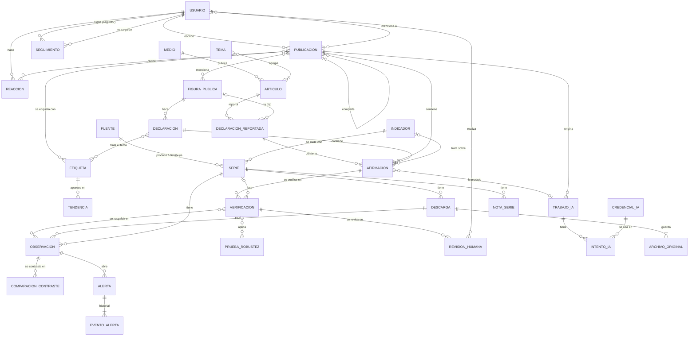

# Modelo entidad-relación (MER) — proyecto final de Bases de Datos

Versión 1 (20 nov 2026). Los diagramas para la presentación, en notación de Chen y en draw.io, están en [diagramas/](../../diagramas/LEEME.md); este documento usa notación de pata de gallo (Mermaid) para leerlo en el repositorio. Modelo **conceptual**: entidades, atributos, relaciones y cardinalidades, sin detalles de implementación. El modelo relacional (tablas, llaves, tipos e índices) está en [02_MR.md](02_MR.md).

## Alcance

El sistema es una red social donde las publicaciones que citan cifras sobre 8 indicadores de Colombia se verifican automáticamente contra el dato oficial. El modelo tiene cuatro áreas:

| Área | Qué guarda | Estado |
| --- | --- | --- |
| **A. Datos oficiales** | Fuentes, indicadores, series, descargas, observaciones, contrastes y alertas | Implementado (migración 0001) |
| **B. Red social** | Usuarios, publicaciones, seguidores, reacciones, etiquetas (hashtags), menciones, figuras públicas y declaraciones | Por implementar |
| **C. Verificación** | Afirmaciones extraídas, verificaciones, evidencia oficial, pruebas de robustez y revisiones humanas | Por implementar |
| **E. Temas del día** | Medios, artículos, temas y declaraciones reportadas por los medios ([06_temas_del_dia.md](06_temas_del_dia.md)) | Por implementar |
| **D. Servicio de IA** | Trabajos de IA, intentos, credenciales (sin secretos) y su estado | Por implementar |

## Diagrama

### Cómo leer las cardinalidades

Notación de pata de gallo: `||` exactamente uno, `o|` cero o uno, `|{` uno o muchos, `o{` cero o muchos (en el lado izquierdo de la línea los mismos símbolos aparecen al revés: `|o`, `}|`, `}o`).

Cada línea `A <izq>--<der> B : verbo` se lee **dos veces, una en cada sentido**. El símbolo que está **pegado a una entidad** dice **cuántas de esa entidad** le corresponden a **una** de la otra:

| Línea | Sentido A → B (símbolo de la derecha, pegado a B) | Sentido B → A (símbolo de la izquierda, pegado a A) |
| --- | --- | --- |
| `USUARIO \|\|--o{ PUBLICACION : escribe` | Un usuario escribe **cero o muchas** publicaciones | Una publicación la escribe **exactamente un** usuario |
| `PUBLICACION o\|--o{ PUBLICACION : "responde a"` | Una publicación recibe **cero o muchas** respuestas | Una publicación responde a **cero o una** publicación (cero si es original) |
| `DESCARGA \|\|--\|{ ARCHIVO_ORIGINAL : guarda` | Una descarga guarda **uno o muchos** archivos | Un archivo pertenece a **exactamente una** descarga |
| `PUBLICACION }o--o{ ETIQUETA : "se etiqueta con"` | Una publicación tiene **cero o muchas** etiquetas | Una etiqueta está en **cero o muchas** publicaciones (N:M; en el MR es la tabla puente `publicacion_etiqueta`) |
| `AFIRMACION }o--o\| TRABAJO_IA : "la produjo"` | Una afirmación la produjo **cero o un** trabajo de IA | Un trabajo de IA produjo **cero o muchas** afirmaciones |

Regla práctica: para saber "¿cuántos B tiene un A?", mira el símbolo pegado a B. El verbo se lee de izquierda a derecha (A *escribe* B).

Del MER al MR: en una relación 1:N la llave foránea va en la tabla del lado "muchos" (`publicacion.autor_id`); en una N:M se crea una tabla puente con las dos llaves.

## Entidades y atributos

Los atributos subrayados en el texto son identificadores. Todas las entidades llevan además fecha de creación.

### B. Red social

| Entidad | Atributos | Notas |
| --- | --- | --- |
| **USUARIO** | <u>id</u>, nombre de usuario (`@handle`, único), nombre visible, correo (único), contraseña cifrada, rol (usuario, verificador, administrador), estado (activo, en revisión, suspendido), biografía | "En revisión" reemplaza a "cuenta sospechosa" (glosario neutral) |
| **PUBLICACION** | <u>id</u>, texto, fecha, estado (visible, retirada por su autor, retirada por moderación) | Puede ser original, respuesta a otra o compartida de otra |
| **SEGUIMIENTO** | fecha | Relación N:M de USUARIO consigo mismo; nadie se sigue a sí mismo |
| **REACCION** | tipo, fecha | Relación N:M entre USUARIO y PUBLICACION; una reacción por usuario y publicación |
| **ETIQUETA** | <u>id</u>, nombre (único, en minúsculas; es el hashtag) | |
| **FIGURA_PUBLICA** | <u>id</u>, nombre, cargo, partido (si es de público conocimiento) | Máximo 10–15 en la v1. A los usuarios no se les asigna partido ni "lado" |
| **DECLARACION** | <u>id</u>, texto, fecha en que se dijo, tipo (declaración o promesa), enlace a la fuente, estado de la promesa | La registra un administrador o verificador. Se liga a una o más etiquetas (temas) para aparecer en la página de la tendencia |
| **TENDENCIA** | ventana de tiempo, puntaje, posición, puntaje de diversidad | Foto de las tendencias de cada ventana; guarda la historia |

### C. Verificación

| Entidad | Atributos | Notas |
| --- | --- | --- |
| **AFIRMACION** | <u>id</u>, texto citado, posición dentro del texto, variante (anual, mensual, año corrido, tasa, conteo…), periodo, territorio, valor dicho, unidad dicha, tipo de comparación (nivel, cambio porcentual, cambio en puntos), confianza de la extracción, estado | Sale de una PUBLICACION **o** de una DECLARACION, nunca de las dos (arco exclusivo) |
| **VERIFICACION** | <u>id</u>, conclusión (se sostiene, se debilita, se invierte, sin dato comparable), explicación, si la explicación pasó el validador de cifras, versión del motor, fecha | Una afirmación puede tener varias versiones; la vigente es la última |
| **PRUEBA_ROBUSTEZ** | <u>código</u>, nombre, descripción | Catálogo: variante equivocada, periodo limitado, nominal frente a real, fuente distinta, dato provisional, nota de serie |
| **VERIFICACION – PRUEBA_ROBUSTEZ** | resultado (sin brecha, brecha encontrada, no aplica), detalle | Atributos de la relación N:M |
| **VERIFICACION – OBSERVACION** | rol (dato citado, dato completo, contraste) | Atributo de la relación N:M: qué dato oficial respalda la conclusión |
| **REVISION_HUMANA** | decisión (confirmada, corregida), motivo, fecha | La hace un USUARIO con rol de verificador |

### E. Temas del día

| Entidad | Atributos | Notas |
| --- | --- | --- |
| **MEDIO** | <u>id</u>, nombre (único), sitio, canal (RSS o GDELT), dirección del canal, habilitado | Lista pública, de distintas líneas editoriales |
| **ARTICULO** | <u>id</u>, URL (única), título, resumen, texto (si el medio lo permite), fecha de publicación, huella | Solo inserción |
| **TEMA** | <u>id</u>, ventana de tiempo, título neutral (sin cifras), etiqueta, total de artículos, total de medios, posición | Lo agrupa la IA; los conteos y el orden los calcula la base. Mínimo 3 medios |
| **DECLARACION_REPORTADA** | <u>id</u>, actor (como lo nombra el artículo), texto citado | La cita debe estar textual en el artículo. Si el actor es una figura registrada, se liga a ella |
| **PALABRA_CLAVE** | indicador, palabra | Filtro previo sin IA: solo pasa a la IA un texto con una cifra y una palabra clave |

### D. Servicio de IA

| Entidad | Atributos | Notas |
| --- | --- | --- |
| **TRABAJO_IA** | <u>id</u>, tipo (extraer afirmaciones, redactar explicación), entrada, huella de la entrada, versión del prompt, estado (en cola, en curso, hecho, fallido), resultado validado, próxima fecha de intento | El resultado se guarda solo si cumple el formato acordado |
| **INTENTO_IA** | número, proveedor, modelo, resultado (correcto, límite alcanzado, error, formato inválido), tokens de entrada y salida, error, inicio y fin | Un trabajo puede tener varios intentos con cuentas distintas |
| **CREDENCIAL_IA** | <u>alias</u>, proveedor, habilitada, en pausa hasta | **No guarda la llave secreta**: la llave vive en la configuración del servicio de IA, bajo el mismo alias |

### A. Datos oficiales (implementado)

FUENTE, INDICADOR, SERIE, DESCARGA, ARCHIVO_ORIGINAL, OBSERVACION, COMPARACION_CONTRASTE, ALERTA, EVENTO_ALERTA, NOTA_SERIE, más la aprobación de series, las diferencias registradas, la evidencia de archivos y el catálogo de brechas de contexto. Están detalladas en [02_MR.md](02_MR.md) y en `db/migrations/0001_official_data.sql`.

## Reglas del negocio que el modelo debe garantizar

1. Una publicación es original, respuesta o compartida; una respuesta tiene exactamente una publicación padre.
2. Un usuario no puede seguirse a sí mismo, ni seguir dos veces a la misma persona.
3. Una reacción por usuario y publicación (se puede cambiar el tipo).
4. Las opiniones no generan afirmaciones: solo se extraen afirmaciones con cifras sobre los 8 indicadores.
5. Una afirmación pertenece a una sola de estas: una publicación, una declaración registrada o una declaración reportada por un medio.
12. La cita de una declaración reportada está textual en el artículo del medio; la IA no puede atribuir frases que no están en la fuente.
13. Un tema necesita al menos 3 medios distintos, y el orden de los temas lo calcula la base, no la IA.
6. Toda verificación con conclusión distinta de "sin dato comparable" tiene al menos una observación oficial como evidencia.
7. Una verificación solo puede usar observaciones oficiales **aceptadas** (no en cuarentena).
8. Una explicación que no pasó el validador de cifras no se publica.
9. Las observaciones oficiales, las verificaciones y los historiales (alertas, intentos de IA, revisiones) no se modifican ni se borran.
10. Ninguna tabla guarda llaves secretas de servicios externos.
11. Ningún usuario ni publicación lleva una etiqueta política.
